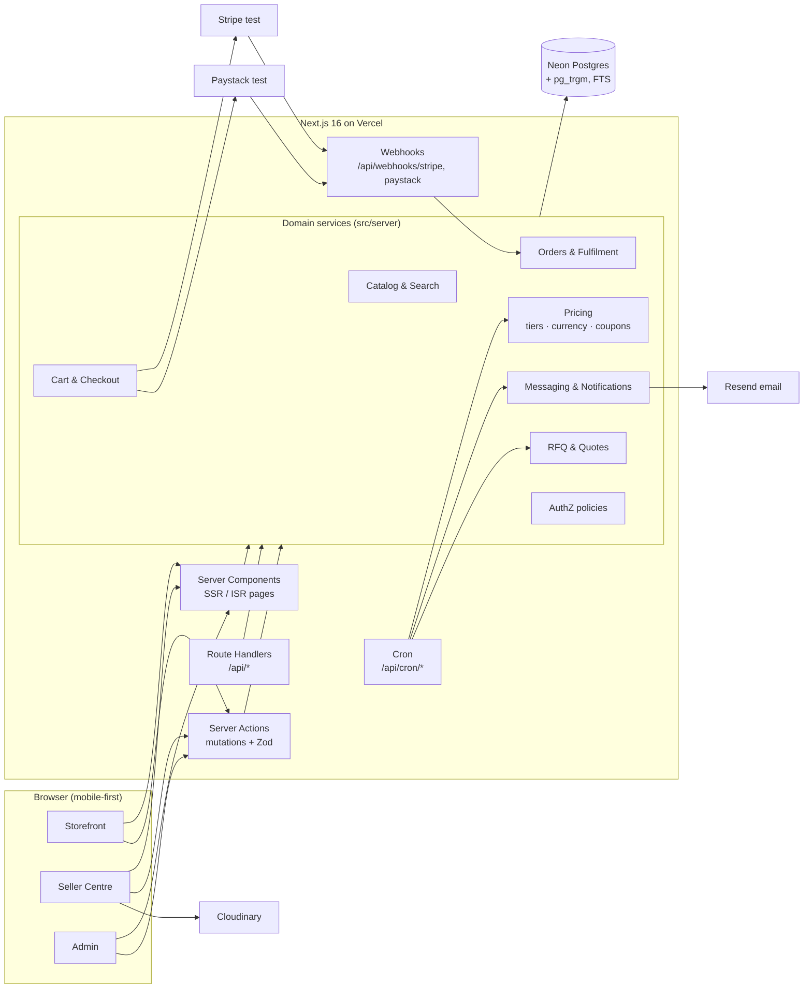
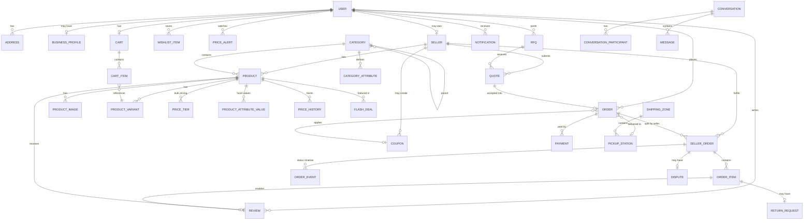
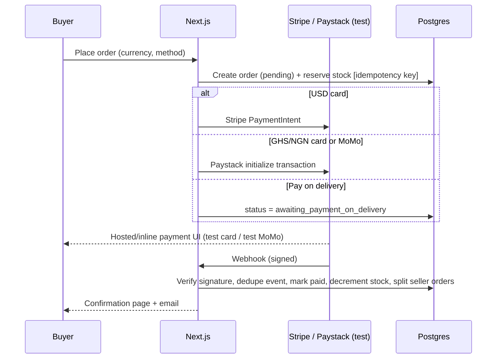

# 03: Design (Architecture, Stack, Data Model, UI)

**Date:** 2026-09-26 · **Status:** Awaiting approval
**Inputs:** [02-requirements.md](02-requirements.md)

> **Last cheap point to change direction.** After this, changing the stack, data model or visual direction means rewriting code.

---

## 1. Tech stack

| Layer | Choice | Why |
|---|---|---|
| Framework | **Next.js 16** (App Router, React 19, Server Components, Server Actions) + **TypeScript (strict)** | SSR/SSG for SEO and fast catalogue pages, one codebase for storefront + seller + admin, industry standard (strong portfolio signal) |
| Styling / UI | **Tailwind CSS v4** + **shadcn/ui** (Radix primitives) + lucide icons | Accessible primitives (dialogs, menus, tabs) out of the box; we own the component code; easy theming via CSS variables |
| Database | **PostgreSQL** on **Neon** (free tier; branchable), with Docker Postgres locally | Relational data (orders, tiers, quotes), with full-text search built in |
| ORM | **Drizzle ORM** + drizzle-kit migrations | Type-safe SQL, lightweight, fast cold starts on serverless, easy raw SQL for search/analytics |
| Auth | **Better Auth** (email/password, Google OAuth, DB sessions, admin/role plugin) | Self-hosted and free, first-class Next.js support, roles built in |
| Search | **Postgres full-text (`tsvector`) + `pg_trgm`** for typo tolerance and autocomplete; facet counts via SQL | No extra service or cost; fast enough for ~10k products. A clean `SearchService` interface allows swapping to Meilisearch later |
| Payments | **Stripe** (USD, cards) + **Paystack** (GHS/NGN, cards + mobile money), both **test mode**; **pay on delivery** | Provider chosen automatically by checkout currency; signature-verified webhooks |
| Images | **Cloudinary** (free tier) for seller uploads; `next/image` for optimisation | CDN, AVIF/WebP, on-the-fly resizing |
| Email | **Resend** (free tier) + React Email templates; logged to the console in dev | Simple API, good-looking transactional emails |
| Charts | **Recharts** | Admin and seller dashboards, price history |
| Forms / validation | react-hook-form + **Zod** (shared client/server schemas) | One schema validates both UI and server actions |
| Scheduled jobs | **Vercel Cron** → `/api/cron/*` (price alerts, flash-deal activation, quote expiry) | Free, no extra infrastructure |
| Testing | **Vitest** (unit/integration), **Playwright** (E2E), **@axe-core/playwright**, Lighthouse CI | Covers the Stage 5 test plan |
| Tooling | pnpm, ESLint, Prettier, GitHub Actions CI | Lint, typecheck and tests on every push |
| Hosting | **Vercel** (Hobby) + Neon | Zero-config Next.js, preview deploy per branch, free |

### Alternatives considered
1. **Medusa v2 (headless commerce) + Next.js storefront:** a ready-made cart, orders and admin. **Rejected** for v1: its multi-vendor, B2B tiers, RFQ and quotes would all need heavy customisation, and showing custom domain logic is a stronger portfolio piece.
2. **Supabase (Postgres + Auth + Storage) instead of Neon + Better Auth + Cloudinary:** fewer vendors. **Viable swap** if you prefer one dashboard. The trade-off is heavier vendor lock-in via Row Level Security and Supabase Auth.
3. **Prisma instead of Drizzle:** friendlier schema DSL, but heavier at runtime. Drizzle suits serverless and raw-SQL search/analytics better.

---

## 2. Architecture



**Principles**
- **Thin UI, fat domain services.** Pages and actions call services in `src/server/*`. Every service method checks authorization through a single `policy` module (role + ownership).
- **Money is stored as integer minor units + currency code** (e.g. `12999` + `GHS`). No floats.
- **Idempotency.** Checkout creates an order with an idempotency key. Webhooks are deduplicated by provider event id.
- **Server-first rendering.** Client JS only for interactive islands (gallery, cart drawer, filters, charts, chat).

### Folder structure
```
src/
  app/
    (store)/            home, search, c/[slug], p/[slug], store/[slug], deals, cart, checkout, rfq
    (account)/account/  orders, wishlist, messages, rfqs, price-alerts, addresses, business
    (auth)/             login, register, forgot-password
    seller/             seller centre (layout guarded: role=seller)
    admin/              admin (layout guarded: role=admin)
    api/                webhooks, cron, search-suggest, upload-sign
  components/
    ui/                 shadcn primitives
    store/ seller/ admin/ shared/
  server/
    db/ (schema.ts, index.ts, seed/)
    services/ (catalog, search, pricing, cart, checkout, orders, rfq, messaging, notifications, reviews, analytics)
    payments/ (stripe.ts, paystack.ts, provider.ts)
    auth/ (better-auth config, policy.ts)
  lib/ (money.ts, currency.ts, format.ts, validators/)
tests/ (unit/, integration/, e2e/)
```

---

## 3. Data model



### Key entities and fields
| Entity | Key fields |
|---|---|
| **user** | id, name, email, emailVerified, image, role (`customer`, `seller`, `admin`), isBusiness, preferredCurrency, disabledAt |
| **business_profile** | userId, companyName, regNumber, country, industry, status (`pending`, `verified`, `rejected`), reviewedBy |
| **seller** | id, userId, slug, name, logoUrl, bannerUrl, story, country, city, status (`pending`, `approved`, `suspended`), isVerified, isStarSeller, baseCurrency, returnWindowDays, policies (json), ratingAvg, ratingCount, responseRate, joinedAt |
| **category** | id, parentId, slug, name, icon, imageUrl, sortOrder (max 3 levels) |
| **category_attribute** | id, categoryId, key, label, type (`enum`, `number`, `bool`), options[], filterable |
| **product** | id, sellerId, categoryId, slug, title, description (rich text), brand, status (`draft`, `published`, `unpublished`, `flagged`), currency, retailPrice (minor), compareAtPrice, moq, leadTimeDays, readyToShip, sampleEnabled, samplePrice, sampleMaxQty, weightGrams, soldCount, ratingAvg, ratingCount, isFeatured, searchVector (tsvector), createdAt |
| **product_variant** | id, productId, sku, options (json, e.g. `{color:"Black", size:"M"}`), priceOverride, stock, lowStockThreshold, reserved |
| **price_tier** | id, productId, minQty, maxQty?, unitPrice (minor): **B2B only** |
| **product_attribute_value** | productId, attributeId, value (drives facets) |
| **price_history** | productId, price, currency, recordedAt (written on every price change + daily snapshot) |
| **price_alert** | id, userId, productId, targetPrice?, currency, active, lastNotifiedAt |
| **review** | id, productId, userId, orderItemId (verified purchase), rating, title, body, images[], helpfulCount, status (`visible`, `hidden`, `reported`), sellerReply, createdAt |
| **wishlist_item** | userId, productId, createdAt |
| **cart / cart_item** | cart: id, userId?, guestToken?, currency, couponId? · item: variantId, qty, isSample |
| **order** | id, number (e.g. `MH-240926-0001`), userId?, guestEmail, currency, subtotal, shippingTotal, discountTotal, taxTotal, grandTotal, deliveryMethod (`doorstep`, `pickup`), shippingAddress (json snapshot), pickupStationId?, paymentMethod (`stripe`, `paystack_card`, `paystack_momo`, `pod`), paymentStatus, isProtected, quoteId?, idempotencyKey, createdAt |
| **seller_order** | id, orderId, sellerId, status (`pending`, `paid`, `processing`, `shipped`, `out_for_delivery`, `at_pickup`, `delivered`, `cancelled`, `refunded`), trackingNumber, subtotal, shippingFee, buyerConfirmedAt |
| **order_item** | id, sellerOrderId, productId, variantId, titleSnapshot, imageSnapshot, unitPrice, qty, isSample, tierApplied |
| **order_event** | sellerOrderId, status, note, actorId, createdAt (the tracking timeline) |
| **payment** | id, orderId, provider, providerRef, amount, currency, status, rawEvent (json), processedEventIds[] |
| **coupon** | id, code, sellerId? (null = platform), type (`percent`, `fixed`), value, minSpend, currency, startsAt, endsAt, usageLimit, usedCount |
| **flash_deal** | id, productId, dealPrice, startsAt, endsAt, stockCap |
| **banner** | id, title, subtitle, imageUrl, href, placement, sortOrder, activeFrom, activeTo |
| **rfq** | id, buyerId, title, categoryId, description, quantity, unit, targetPrice?, currency, deliveryCountry, deadline, attachments[], status (`open`, `closed`, `awarded`, `expired`) |
| **quote** | id, rfqId, sellerId, unitPrice, currency, moq, leadTimeDays, shippingCost, validUntil, note, status (`submitted`, `accepted`, `declined`, `expired`) |
| **conversation / participant / message** | conversation: id, productId?, rfqId?, quoteId? · participant: conversationId, userId, lastReadAt · message: id, conversationId, senderId, body, attachments[], createdAt |
| **notification** | id, userId, type, title, body, href, readAt |
| **shipping_zone** | id, country, region, doorstepFee, pickupFee, etaDaysMin, etaDaysMax, podEnabled |
| **pickup_station** | id, zoneId, name, address, hours, lat, lng |
| **currency_rate** | code (`GHS`, `NGN`, `USD`), rateToUsd, updatedAt |
| **return_request / dispute** *(Should)* | orderItemId / sellerOrderId, reason, photos[], status, resolution, resolvedBy |
| **audit_log** *(Should)* | actorId, action, entity, entityId, diff (json), createdAt |
| **recently_viewed** *(Should)* | userId/guestToken, productId, viewedAt |

### Pricing rules (single source of truth: `pricing.service`)
1. Base unit price = variant `priceOverride` ?? product `retailPrice`.
2. If the buyer **is a verified business** (or qty ≥ the lowest tier's `minQty` and the seller allows public tiers), apply the matching `price_tier`.
3. An active `flash_deal` overrides the price when it is lower (retail only, qty ≤ stockCap).
4. Samples use `samplePrice`, qty ≤ `sampleMaxQty`, and ignore MOQ.
5. MOQ is enforced for non-sample lines.
6. Coupon applied → shipping (zone + method, per seller sub-order) → currency conversion for display. **Checkout charges in the buyer's selected currency** using the rates locked at order time.

---

## 4. Routes and API

### Pages
See the sitemap in [02-requirements.md §6](02-requirements.md). Access guards:
- `/account/*` → signed in
- `/seller/*` → `role=seller` and seller `approved` (except `/seller/apply`)
- `/admin/*` → `role=admin`

### Server Actions (mutations, all Zod-validated and policy-checked)
| Area | Actions |
|---|---|
| Cart | `addToCart`, `updateCartItem`, `removeCartItem`, `applyCoupon`, `removeCoupon`, `setCurrency` |
| Checkout | `createCheckout` → returns provider session/reference; `placePodOrder` |
| Account | `updateProfile`, `upsertAddress`, `deleteAddress`, `toggleWishlist`, `createPriceAlert`, `deletePriceAlert`, `requestBusinessUpgrade`, `confirmReceipt`, `openDispute`*, `requestReturn`* |
| Reviews | `createReview`, `updateReview`, `voteHelpful`, `reportReview`, `replyToReview`* |
| B2B | `createRfq`, `closeRfq`, `acceptQuote`, `declineQuote` |
| Messaging | `startConversation`, `sendMessage`, `markRead` |
| Seller | `applyAsSeller`, `upsertProduct`, `setProductStatus`, `bulkUpdateInventory`, `updateSellerOrderStatus`, `submitQuote`, `updateStorefront`, `upsertSellerCoupon`* |
| Admin | `reviewSeller`, `setSellerBadges`, `reviewBusinessProfile`, `moderateProduct`, `upsertCategory`, `moveCategory`, `adminUpdateOrder`, `refundOrder`, `setUserRole`, `disableUser`, `moderateReview`, `upsertCoupon`, `upsertFlashDeal`, `upsertBanner`, `updateSettings`, `resolveDispute`*, `resetDemoData` |

\* Should items

### Route handlers (`/api`)
| Route | Purpose |
|---|---|
| `GET /api/search/suggest?q=` | Autocomplete (products, categories, suppliers), edge-cached briefly |
| `POST /api/webhooks/stripe` | `payment_intent.succeeded` / `charge.refunded`, signature-verified, idempotent |
| `POST /api/webhooks/paystack` | `charge.success` / `refund.processed`, HMAC SHA-512 verified, idempotent |
| `GET /api/cron/price-alerts` | Checks watched prices and notifies (Vercel Cron, secret-protected) |
| `GET /api/cron/housekeeping` | Expires quotes/RFQs, releases stale stock reservations, snapshots price history |
| `POST /api/upload/sign` | Signed Cloudinary upload params (seller/admin only) |
| `GET /api/auth/*` | Better Auth |
| `GET /sitemap.xml`, `/robots.txt` | SEO |

### Payment flow


---

## 5. Auth and roles

| Capability | Guest | Customer | Business buyer | Seller | Admin |
|---|:-:|:-:|:-:|:-:|:-:|
| Browse, search, cart, guest checkout | ✅ | ✅ | ✅ | ✅ | ✅ |
| Reviews, wishlist, price alerts, messages | – | ✅ | ✅ | ✅ | ✅ |
| See/apply tier pricing without meeting min qty; post RFQ; order samples | – | – | ✅ | – | ✅ |
| Seller Centre (own data only) | – | – | – | ✅ | – |
| Admin (all data) | – | – | – | – | ✅ |

- A **business buyer** is a `customer` with `isBusiness=true` after admin verification. A seller account can also buy.
- **Ownership checks** in `policy.ts`, e.g. `canEditProduct(user, product) = user.role==='admin' || product.sellerId===user.sellerId`.
- **Demo logins:** `shopper@demo`, `business@demo`, `seller@demo`, `admin@demo`, via a "Try as…" switcher (enabled only when `DEMO_MODE=true`).
- Sessions are HTTP-only secure cookies. Auth endpoints are rate-limited. Passwords are hashed (scrypt/argon2 via Better Auth).

---

## 6. Visual design and design tokens

**Direction:** "Calm premium marketplace." Etsy-like whitespace and typography with Amazon-like information hierarchy. It is intentionally **not orange**, so it reads as its own brand rather than an Amazon or Alibaba clone. Business mode gets its own indigo accent, so users always know which pricing they are seeing.

### Colour (all text pairs checked ≥ 4.5:1)
| Token | Light | Dark | Use |
|---|---|---|---|
| `--bg` | `#FFFFFF` | `#0B1220` | Page |
| `--surface` | `#F6F7F9` | `#111A2E` | Cards, sections |
| `--border` | `#E3E6EB` | `#1F2A44` | Dividers |
| `--text` | `#0F172A` | `#E6EAF2` | Body |
| `--text-muted` | `#475569` (7.6:1) | `#94A3B8` (7.3:1) | Secondary |
| `--primary` | `#0B7A62` teal (5.3:1) | `#34D3A6` | Primary CTAs, links |
| `--primary-fg` | `#FFFFFF` | `#04241C` | Text on primary |
| `--deal` | `#C2410C` coral-orange (5.2:1) | `#FB923C` | Flash deals, discounts, countdowns |
| `--business` | `#4338CA` indigo (7.9:1) | `#A5B4FC` | Business mode, tier tables, RFQ |
| `--rating` | `#B45309` amber (5.0:1) | `#FBBF24` | Stars |
| `--success` | `#15803D` | `#4ADE80` | In stock, delivered |
| `--danger` | `#B91C1C` | `#F87171` | Errors, low stock |

### Typography
- **Headings:** *Plus Jakarta Sans* (600/700). **Body/UI:** *Inter* (400/500/600). Both self-hosted via `next/font`.
- Scale (rem): 0.75 · 0.875 · **1 (base 16px)** · 1.125 · 1.25 · 1.5 · 1.875 · 2.25 · 3.
- Prices use tabular numerals (`font-variant-numeric: tabular-nums`).

### Spacing, radius, elevation, motion
- 4px base spacing scale (Tailwind default). Container max width 1440px; gutter 16px mobile / 24px tablet / 32px desktop.
- Radius: `sm 6px` (inputs), `md 10px` (buttons, cards), `lg 16px` (modals, hero), `full` (chips, avatars).
- Shadows: subtle, two levels (`card`, `popover`). Borders do most of the separation.
- Motion: 150–200 ms ease-out; all non-essential motion disabled under `prefers-reduced-motion`.
- Breakpoints: `sm 640`, `md 768`, `lg 1024`, `xl 1280`, `2xl 1440`.

---

## 7. Component inventory

**Primitives (shadcn/ui):** Button, Input, Textarea, Select, Checkbox, RadioGroup, Switch, Slider (price range), Dialog, Sheet (drawers), DropdownMenu, Popover, Command (search palette), Tabs, Accordion, Tooltip, Toast (Sonner), Badge, Avatar, Skeleton, Table, Pagination, Breadcrumb, Card, Separator, Form.

**Shared / layout:** `SiteHeader` (logo, search with scope, currency switcher, Retail/Business toggle, account menu, cart), `MegaMenu`, `MobileNav`, `SiteFooter`, `DemoBanner`, `RoleSwitcher`, `Price` (currency-aware, strike-through, tabular), `RatingStars`, `EmptyState`, `DataTable` (sorting, filtering, pagination, bulk actions, used in seller and admin), `StatCard`, `Chart` wrappers, `ImageUploader` (drag-reorder, alt-text required), `RichTextEditor` (Tiptap), `NotificationBell`, `Countdown` (accessible).

**Storefront:** `HeroCarousel` (pausable), `CategoryGrid`, `ProductCard` (image, title, price, rating, "X sold", badges, wishlist heart, MOQ chip in business mode), `ProductRail`, `FlashDealRail`, `SearchAutocomplete`, `FacetSidebar` + `FacetSheet` (mobile), `SortSelect`, `ActiveFilterChips`, `ProductGallery` (zoom, thumbnails, swipe), `VariantPicker`, `BuyBox` (retail) / `BulkBuyBox` (tier table + qty stepper + MOQ + Request quote + Order sample), `DeliveryEstimate`, `SellerCard` (trust stats + badges), `SpecsTable`, `ReviewSummary` (histogram), `ReviewList`, `ReviewForm`, `PriceHistoryChart`, `PriceAlertButton`, `FrequentlyBoughtTogether`, `CartDrawer`, `CartLineItem`, `OrderSummary`, `CheckoutStepper`, `AddressForm`, `DeliveryMethodPicker` (doorstep / pickup station list), `PaymentMethodPicker` (card / MoMo / POD by currency), `OrderTimeline`, `RfqForm`, `QuoteComparisonTable`, `ChatThread` / `ChatComposer`, `SellerStoreHeader`.

**Seller Centre:** `SellerSidebar`, `SellerKpis`, `ProductForm` (tabs: Basics · Media · Variants & stock · Pricing & tiers · B2B options · Shipping · SEO), `TierEditor`, `VariantMatrixEditor`, `InventoryTable` (inline edit), `SellerOrderTable`, `ShipOrderDialog`, `PackingSlip` (print CSS), `RfqInbox`, `QuoteForm`, `StorefrontEditor`.

**Admin:** `AdminSidebar`, `AdminKpis`, `RevenueChart`, `TopTables`, `ApprovalQueue` (sellers / business verifications / flagged products / reported reviews), `CategoryTreeEditor` (drag-and-drop), `AttributeEditor`, `OrderAdminDetail`, `UserTable`, `CouponForm`, `FlashDealScheduler`, `BannerManager`, `SettingsForms` (currencies, shipping zones, pickup stations, payments), `ResetDemoButton`.

---

## 8. Low-fidelity wireframes

### 8.1 Header (desktop)
```
┌──────────────────────────────────────────────────────────────────────────────────────┐
│ [MarketHub]  [All ▾│ Search products, suppliers…                      🔍]  GHS▾      │
│                                                   Retail|Business  Hi, Ama▾  ♡  🛒 3 │
├──────────────────────────────────────────────────────────────────────────────────────┤
│ ☰ All categories   Today's Deals   Ready to Ship   Request a Quote   Sell on MarketHub│
└──────────────────────────────────────────────────────────────────────────────────────┘
```

### 8.2 Home
```
┌ Header ──────────────────────────────────────────────────────────────────────────────┐
├──────────────────────────────────────────┬───────────────────────────────────────────┤
│  HERO CAROUSEL (pausable)                │  Welcome card: Sign in / Your orders      │
│  "Back-to-school tech deals"  [Shop now] │  Business? [Post an RFQ →]                │
├──────────────────────────────────────────┴───────────────────────────────────────────┤
│ Shop by category   [📱][👗][🏠][💄][⚽][🔧][🍳][🧸]  →                                   │
├──────────────────────────────────────────────────────────────────────────────────────┤
│ ⚡ Flash Deals   ends in 04:12:33                                        See all →     │
│ [card][card][card][card][card][card] →                                               │
├──────────────────────────────────────────────────────────────────────────────────────┤
│ Recommended for you       [card][card][card][card][card][card]                       │
│ Ready to Ship · Bulk      [card+MOQ][card+MOQ][card+MOQ]…                             │
│ Top-rated sellers         [seller][seller][seller][seller]                           │
├──────────────────────────────────────────────────────────────────────────────────────┤
│ Trust strip: 🛡 Protected Orders · 📍 Pickup stations · 📱 MoMo · 💳 Cards · ↩ Returns │
└ Footer ──────────────────────────────────────────────────────────────────────────────┘
```

### 8.3 Search / category results
```
┌ Header ──────────────────────────────────────────────────────────────────────────────┐
│ Home › Electronics › Phone accessories         1,284 results for "power bank"        │
│ [Products | Suppliers]                                   Sort: [Relevance ▾]  ⊞ ≡    │
├──────────────────────┬───────────────────────────────────────────────────────────────┤
│ FILTERS              │ Active: [Under GHS 300 ×] [4★ & up ×]  Clear all              │
│ Category ▸           │ ┌──────┐ ┌──────┐ ┌──────┐ ┌──────┐                           │
│ Price  [—●——●—]      │ │ img  │ │ img  │ │ img  │ │ img  │                           │
│ Rating ★★★★ & up     │ │title │ │title │ │title │ │title │                           │
│ Brand  ☐ Anker ☐ …   │ │★4.6  │ │★4.2  │ │★4.8  │ │★4.1  │                           │
│ Seller location ▸    │ │GHS249│ │GHS199│ │GHS310│ │GHS180│                           │
│ ☐ Ready to Ship      │ │1.2k  │ │MOQ 10│ │✓Verif│ │⚡Deal│                           │
│ MOQ ≤ [  50 ]        │ └──────┘ └──────┘ └──────┘ └──────┘                           │
│ ☐ Verified supplier  │  …                                                            │
│ ☐ In stock           │                 [‹ 1 2 3 … 54 ›]                               │
└──────────────────────┴───────────────────────────────────────────────────────────────┘
Mobile: filters open in a bottom sheet via [Filters (2)] sticky button.
```

### 8.4 Product detail
```
┌ Breadcrumb ──────────────────────────────────────────────────────────────────────────┐
├─────────────────────────┬──────────────────────────────┬─────────────────────────────┤
│ ┌───────────────────┐   │ Anker-style 20,000mAh Power  │ ┌─ RETAIL BUY BOX ────────┐ │
│ │                   │   │ Bank, 22.5W fast charge       │ │ GHS 249.00  ~~GHS 299~~ │ │
│ │   MAIN IMAGE      │   │ ★★★★☆ 4.6 (812) · 3.4k sold  │ │ 🚚 Arrives Tue, 30 Sep   │ │
│ │   (zoom)          │   │ by VoltHub ✓Verified ★Star   │ │    or pickup Mon (GHS 10)│ │
│ └───────────────────┘   │ Colour: (●Black)(○White)     │ │ ✓ In stock (43)          │ │
│ [t][t][t][t][t]         │ Capacity: [10k][20k*][30k]   │ │ Qty [- 1 +]              │ │
│                         │ • 22.5W PD fast charging     │ │ [ Add to Cart ]          │ │
│                         │ • Charges 3 devices          │ │ [ Buy Now ]              │ │
│                         │ • …                          │ │ 🛡 Protected Order        │ │
│                         │                              │ │ ♡ Wishlist  🔔 Watch price│ │
│                         │ ┌ BUSINESS PRICING ────────┐ │ └──────────────────────────┘ │
│                         │ │ 10–99   GHS 215 /unit    │ │ ┌ SELLER ─────────────────┐ │
│                         │ │ 100–499 GHS 198 /unit    │ │ │ VoltHub · Shenzhen/Accra│ │
│                         │ │ 500+    GHS 182 /unit    │ │ │ 5 yrs · 98% response    │ │
│                         │ │ MOQ 10 · Lead time 7 days│ │ │ [Message] [Visit store] │ │
│                         │ │ [Order sample GHS 260]   │ │ └──────────────────────────┘ │
│                         │ │ [Request a quote]        │ │                             │
│                         │ └──────────────────────────┘ │                             │
├─────────────────────────┴──────────────────────────────┴─────────────────────────────┤
│ Frequently bought together:  [img] + [img] + [img]  = GHS 312   [Add all 3]          │
├──────────────────────────────────────────────────────────────────────────────────────┤
│ [Description] [Specifications] [Shipping & returns] [Price history 📈]               │
├──────────────────────────────────────────────────────────────────────────────────────┤
│ Customer reviews   4.6 ★  ▇▇▇▇▇ 5★ 68%  ▇▇ 4★ 20% … [Write a review]                 │
│ "Customers say: fast charging, solid build; some mention weight."                    │
│ [Filter: All ★ ▾] [With photos] [Sort: Most helpful ▾]                               │
│ ★★★★★ Kofi A. · Verified purchase · 12 Sep   "Charges my phone 4 times…" 👍 24        │
├──────────────────────────────────────────────────────────────────────────────────────┤
│ Customers also viewed [rail]   ·   More from VoltHub [rail]                          │
└──────────────────────────────────────────────────────────────────────────────────────┘
Mobile: gallery → title/price → sticky bottom bar [♡][Add to Cart][Buy Now].
```

### 8.5 Checkout (single column, linear)
```
① Contact & address  ──  ② Delivery  ──  ③ Payment  ──  ④ Review
┌────────────────────────────────────────────┬──────────────────────────┐
│ Email (guest)  [                     ]      │ ORDER SUMMARY            │
│ Already have an account? Sign in           │ VoltHub (2 items)        │
│ Full name [          ] Phone [          ]  │   Power bank ×1  249.00  │
│ Country [Ghana ▾] Region [Greater Accra▾]  │ StyleCo (1 item)         │
│ Address [                               ]  │   Tote bag ×1     89.00  │
│ ─────────────────────────────────────────  │ Subtotal        338.00   │
│ ② (●) Doorstep  GHS 25 · Tue 30 Sep        │ Shipping         25.00   │
│   (○) Pickup station  GHS 10 · Mon 29 Sep  │ Discount (WELCOME10) −33 │
│       [Choose station ▾ Accra Mall]        │ Total  GHS 330.00        │
│ ③ (●) Mobile Money (Paystack)              │ [ Place order ]          │
│   (○) Card (Paystack)                       │ 🛡 Protected · 🔒 Test mode│
│   (○) Pay on delivery                       │                          │
└────────────────────────────────────────────┴──────────────────────────┘
```

### 8.6 RFQ quote comparison (business buyer)
```
RFQ #R-1042 "20,000 power banks, custom logo"  · Qty 5,000 · Target USD 6.50 · 4 quotes
┌─────────────┬──────────┬─────────┬──────┬──────────┬──────────┬───────┬──────────────┐
│ Supplier    │ Unit     │ Total   │ MOQ  │ Lead time│ Shipping │Rating │              │
├─────────────┼──────────┼─────────┼──────┼──────────┼──────────┼───────┼──────────────┤
│ VoltHub ✓   │ $6.20 ↓  │ $31,000 │ 1000 │ 15 days  │ $1,200   │ ★4.8  │[Accept][Chat]│
│ PowerMax ✓  │ $6.45    │ $32,250 │  500 │ 10 days ⚡│ $900 ↓   │ ★4.6  │[Accept][Chat]│
│ …           │          │         │      │          │          │       │              │
└─────────────┴──────────┴─────────┴──────┴──────────┴──────────┴───────┴──────────────┘
Best values are highlighted per column; sortable; mobile = stacked cards.
```

### 8.7 Seller Centre dashboard
```
┌ Sidebar ─────┬───────────────────────────────────────────────────────────────────────┐
│ Dashboard    │ Sales 30d GHS 48,210 ▲12% │ To ship 7 │ Open RFQs 3 │ Unread 5 │ Low 4 │
│ Products     ├───────────────────────────────────────────────────────────────────────┤
│ Inventory    │ [ Sales chart — 30 days ]                                             │
│ Orders       ├──────────────────────────────────┬────────────────────────────────────┤
│ RFQs         │ Orders to fulfil (table)          │ Matching RFQs (list) [Quote →]    │
│ Messages     │                                    │ Low-stock items (list)            │
│ Storefront   │                                    │                                   │
└──────────────┴──────────────────────────────────┴────────────────────────────────────┘
```

### 8.8 Admin dashboard
```
┌ Sidebar ────────┬────────────────────────────────────────────────────────────────────┐
│ Overview        │ GMV │ Orders │ AOV │ New users │ New sellers │ Pending approvals (6) │
│ Sellers  (3)    ├────────────────────────────────────────────────────────────────────┤
│ Businesses (2)  │ [ Revenue by day — line ]      [ Revenue by category — bar ]        │
│ Products  (1⚑)  │ [ Orders by country — bar ]    [ Payment method mix — bar ]         │
│ Categories      ├────────────────────────────────────────────────────────────────────┤
│ Orders          │ Top products (table)            Top sellers (table)                 │
│ Users           │ Approval queue: sellers · business verifications · flags · reports │
│ Reviews   (2⚑)  │                                                                     │
│ Promotions      │                                                                     │
│ Settings        │                          [Reset demo data]                          │
└─────────────────┴────────────────────────────────────────────────────────────────────┘
```

---

## 9. Seed data plan
- **Categories:** 8 top-level categories (Electronics, Fashion, Home & Kitchen, Beauty, Sports, Industrial & Tools, Groceries, Toys), with 2–3 levels and ~40 leaves.
- **Sellers:** 12, spanning Ghana, Nigeria, China, UK and US. A mix of Verified and Star Seller, plus 2 pending applications.
- **Products:** ~200, each with 3–5 images, variants, and 60% having B2B tiers, MOQ and samples.
- **Reviews:** ~1,500 reviews. 12 months of price history. ~300 orders across all statuses.
- **Other:** 8 RFQs with quotes, message threads, coupons, 6 flash deals, 3 banners, shipping zones (Ghana regions, Nigeria states, International) and 10 pickup stations.
- **Product images:** royalty-free photos (Unsplash licence) referenced via the Unsplash CDN, with attribution in the README. Brand names in product titles are **fictional**.

---

## 10. Open decisions for you
1. **Stack:** Next.js + Neon + Drizzle + Better Auth (recommended) **or** swap to Supabase for fewer vendors?
2. **Visual direction:** teal primary + coral deals + indigo business mode. OK, or do you have brand colours or a name other than "MarketHub"?
3. **Accounts you'll need at deploy time** (all free): Vercel, Neon, Stripe (test), Paystack (test), Cloudinary, Resend, Google OAuth client. None are needed until Stage 6. Locally, everything runs with Docker Postgres and mock providers.
4. **Prototype:** would you like a clickable HTML prototype of the home and product pages before we lock this in?
